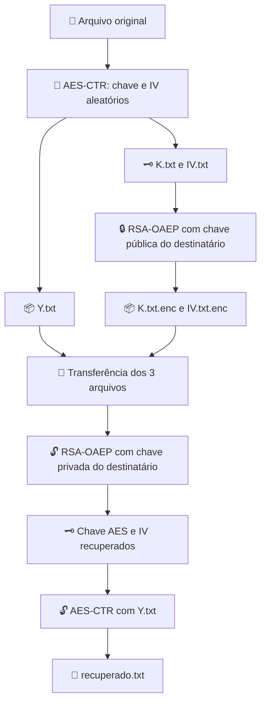
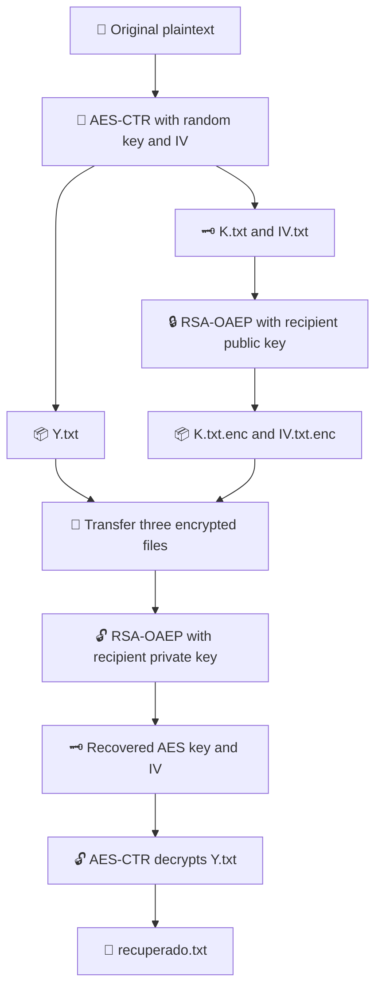

<div align="center">

# 🔐 Giovielle Crypto

### Criptografia de arquivos com AES-CTR e proteção de chaves com RSA-OAEP
### File encryption with AES-CTR and RSA-OAEP key protection

**Java 21 ☕ · Gradle 🐘 · AES-128/256 🔒 · RSA-3072 🗝️ · CLI 💻**

**[🇧🇷 Documentação em português](#-português) · [🇺🇸 English documentation](#-english)**

</div>

---

# 🇧🇷 Português

## 📖 Sobre o projeto

O **Giovielle Crypto** é uma aplicação de linha de comando (CLI) desenvolvida em **Java 21**, para a disciplina de **Criptografia Aplicada**, do curso de **Segurança da Informação da Unisinos**.

Seu objetivo é garantir a **confidencialidade de arquivos de texto** e permitir que duas pessoas realizem, em execuções independentes, os processos de criptografia e descriptografia.

A aplicação utiliza dois mecanismos complementares:

- **AES no modo CTR (Counter)** para criptografar o conteúdo do arquivo, com chave de **128 ou 256 bits** selecionada pelo usuário.
- **RSA de 3072 bits com OAEP/SHA-256** para proteger a chave AES gerada e o vetor de inicialização (IV), permitindo que o destinatário os recupere usando sua chave privada.

> 💡 **Exemplo:** Gabrielle criptografa um arquivo usando AES-CTR, protege a chave AES e o IV com a chave pública de Giovana e envia somente os arquivos protegidos. Giovana utiliza sua chave privada RSA para recuperar os parâmetros e, em seguida, descriptografa a mensagem com AES-CTR.

### 🎯 Requisitos atendidos

| Requisito | Implementação |
| --- | --- |
| Gerar par de chaves assimétricas associado ao nome | Arquivos `<nome>.pu` e `<nome>.pr` |
| Selecionar um arquivo de texto | Caminho informado no terminal |
| Gerar chave simétrica pseudoaleatória | AES-128 ou AES-256, à escolha do usuário |
| Gerar IV pseudoaleatório | 16 bytes para AES-CTR |
| Criptografar o conteúdo do arquivo | `AES/CTR/NoPadding` → `Y.txt` |
| Proteger chave e IV separadamente | RSA-OAEP com chave pública → arquivos `.enc` |
| Recuperar chave e IV | RSA-OAEP com chave privada → arquivos `.recovered` |
| Recuperar o arquivo original | Descriptografia AES-CTR → `recuperado.txt` |
| Executar cifragem e decifragem independentemente | Operações separadas no menu; teste com dois usuários descrito abaixo |

## 🧠 Como a criptografia funciona



**Por que combinar AES e RSA?** O AES é eficiente para criptografar arquivos de qualquer tamanho, enquanto o RSA permite proteger pequenas informações, como a chave AES. O arquivo de texto **não é criptografado diretamente com RSA**.

### 🛡️ Escolhas técnicas

| Componente | Configuração |
| --- | --- |
| Linguagem | Java 21 |
| Gerenciamento de build | Gradle Wrapper |
| Criptografia do arquivo | `AES/CTR/NoPadding` |
| Tamanho da chave AES | 128 ou 256 bits |
| Tamanho do IV AES-CTR | 128 bits (16 bytes) |
| Geração pseudoaleatória | Geradores criptograficamente seguros da API Java |
| Algoritmo assimétrico | RSA, 3072 bits |
| Proteção dos parâmetros | RSA-OAEP, SHA-256, MGF1 com SHA-256 |
| Formato da chave pública | DER / X.509 (`.pu`) |
| Formato da chave privada | DER / PKCS#8 (`.pr`) |
| Formato de `Y.txt`, `K.txt`, `IV.txt` e `.enc` | Texto hexadecimal |

> 📝 No nome Java `RSA/ECB/OAEPPadding`, o trecho `ECB` é uma convenção de nomenclatura do provedor para RSA; não significa que estamos usando AES-ECB.

## 🧰 Pré-requisitos

- ☕ **Java 21** instalado (JDK recomendado para desenvolvimento; runtime compatível para executar a distribuição).
- 🖥️ Terminal no macOS, Linux ou Windows.
- 📁 Código-fonte do repositório, incluindo o **Gradle Wrapper** (`gradlew`, `gradlew.bat` e `gradle/wrapper/`).
- 🌐 Acesso à internet na primeira execução, caso o Gradle precise baixar dependências.

Confira a instalação:

```bash
java -version
```

O resultado precisa indicar **Java 21** para a execução da aplicação compilada.

> ✅ Não é necessário instalar o Gradle globalmente: o projeto já usa o **Gradle Wrapper**.

## 🚀 Como executar

### 1. Abra o projeto

No terminal, entre na pasta-raiz, que contém o arquivo `gradlew`:

```bash
cd giovielle-crypto
```

Se a pasta estiver em outro local, navegue até ela usando o caminho correspondente.

### 2. Compile e execute os testes

**macOS / Linux:**

```bash
./gradlew :app:build
```

**Windows (PowerShell):**

```powershell
.\gradlew.bat :app:build
```

O comando `build` compila a aplicação e executa os testes configurados. O resultado esperado é `BUILD SUCCESSFUL`.

### 3. Inicie o menu

**macOS / Linux:**

```bash
./gradlew :app:run --console=plain
```

**Windows (PowerShell):**

```powershell
.\gradlew.bat :app:run --console=plain
```

O programa apresenta:

```text
=== Giovielle Crypto ===
1. Gerar par de chaves RSA
2. Carregar chaves RSA existentes
3. Criptografar arquivo com AES-CTR
4. Proteger chave AES ou IV com RSA
5. Recuperar chave AES ou IV com RSA
6. Descriptografar arquivo com AES-CTR
Escolha uma opção:
```

⚠️ **Importante sobre caminhos:** quando usamos `./gradlew :app:run`, a aplicação utiliza **`app/` como diretório de trabalho**. Assim:

| No terminal na raiz do repositório | Dentro do menu da aplicação |
| --- | --- |
| `app/message.txt` | `message.txt` |
| `app/keys/Giovana.pu` | `keys/Giovana.pu` |
| `app/output/UUID/K.txt` | `output/UUID/K.txt` |

`UUID` representa o identificador da pasta gerada na sua própria execução: **substitua pelo valor real**. Não digite literalmente `UUID` nem `...`.

## 🗂️ Organização do projeto

```text
giovielle-crypto/
├── app/
│   ├── build.gradle
│   ├── src/
│   │   ├── main/java/com/giovielle/crypto/
│   │   │   ├── Main.java
│   │   │   ├── service/
│   │   │   │   ├── AesService.java
│   │   │   │   └── RsaKeyService.java
│   │   │   └── utils/
│   │   │       └── FileUtils.java
│   │   └── test/java/com/giovielle/crypto/service/
│   │       ├── AesServiceTest.java
│   │       └── RsaKeyServiceTest.java
│   ├── keys/                 # Gerada durante o uso; não versionar
│   └── output/               # Gerada durante o uso; não versionar
├── gradle/wrapper/
├── gradlew
├── gradlew.bat
└── README.md
```

Os diretórios `keys/` e `output/` contêm dados de execução e podem não existir antes da primeira operação.

## 🎮 Guia completo das opções do menu

### 1️⃣ Gerar par de chaves RSA

Escolha **`1`** e digite o nome desejado, por exemplo:

```text
Escolha uma opção: 1
Digite seu nome: Giovana
```

Arquivos esperados:

```text
app/keys/Giovana.pu   # 🔓 Chave pública: pode ser compartilhada
app/keys/Giovana.pr   # 🔐 Chave privada: deve ficar com Giovana
```

O par utiliza RSA de 3072 bits. A aplicação evita sobrescrever arquivos de chaves já existentes.

### 2️⃣ Carregar e verificar chaves existentes

Escolha **`2`** e informe o mesmo nome usado na criação:

```text
Escolha uma opção: 2
Digite seu nome: Giovana
```

O sistema carrega `.pu` e `.pr` e verifica se correspondem ao mesmo par RSA usando assinatura e verificação digital.

### 3️⃣ Criptografar um arquivo com AES-CTR

Coloque um arquivo de texto na pasta `app/`, por exemplo `app/message.txt`.

```text
Escolha uma opção: 3
Caminho do arquivo TXT: message.txt
Tamanho da chave AES (128 ou 256): 256
```

A aplicação gera uma chave AES e um IV pseudoaleatórios, cria uma pasta exclusiva em `app/output/` e salva:

```text
app/output/UUID/
├── Y.txt    # 🔐 Conteúdo criptografado com AES-CTR, em hexadecimal
├── K.txt    # 🗝️ Chave AES original, em hexadecimal
└── IV.txt   # 🔢 IV original, em hexadecimal
```

**Comprimentos esperados:**

| Arquivo | Conteúdo hexadecimal |
| --- | --- |
| `K.txt` com AES-128 | 32 caracteres = 16 bytes |
| `K.txt` com AES-256 | 64 caracteres = 32 bytes |
| `IV.txt` | 32 caracteres = 16 bytes |
| `Y.txt` | 2 caracteres por byte do arquivo original |

🔎 O modo CTR não acrescenta padding ao conteúdo. O arquivo cifrado possui a mesma quantidade de bytes do arquivo original **antes** da conversão para hexadecimal.

### 4️⃣ Proteger a chave AES e o IV com RSA

Execute a opção **`4` duas vezes**, uma para `K.txt` e outra para `IV.txt`, utilizando a **chave pública do destinatário**.

**Primeira execução — chave AES:**

```text
Escolha uma opção: 4
Caminho do arquivo K.txt ou IV.txt: output/UUID/K.txt
Caminho da chave pública RSA (.pu): keys/Giovana.pu
```

Saída: `output/UUID/K.txt.enc`.

**Segunda execução — IV:**

```text
Escolha uma opção: 4
Caminho do arquivo K.txt ou IV.txt: output/UUID/IV.txt
Caminho da chave pública RSA (.pu): keys/Giovana.pu
```

Saída: `output/UUID/IV.txt.enc`.

🔒 Com RSA-3072, cada arquivo `.enc` tem **384 bytes cifrados, ou 768 caracteres hexadecimais**.

### 5️⃣ Recuperar a chave AES e o IV com RSA

O destinatário usa a opção **`5` duas vezes**, agora com a **própria chave privada**:

```text
Escolha uma opção: 5
Caminho do arquivo protegido (.enc): output/UUID/K.txt.enc
Caminho da chave privada RSA (.pr): keys/Giovana.pr
```

Saída: `K.txt.recovered`.

Depois:

```text
Escolha uma opção: 5
Caminho do arquivo protegido (.enc): output/UUID/IV.txt.enc
Caminho da chave privada RSA (.pr): keys/Giovana.pr
```

Saída: `IV.txt.recovered`.

Os arquivos `.recovered` contêm os parâmetros recuperados em hexadecimal e **devem ser tratados como informações sensíveis**.

### 6️⃣ Descriptografar o arquivo com AES-CTR

Selecione **`6`** e informe os três arquivos necessários:

```text
Escolha uma opção: 6
Caminho do arquivo criptografado (Y.txt): output/UUID/Y.txt
Caminho da chave AES recuperada: output/UUID/K.txt.recovered
Caminho do IV recuperado: output/UUID/IV.txt.recovered
```

A aplicação reconstrói a chave AES a partir dos bytes recuperados e produz:

```text
output/UUID/recuperado.txt
```

✅ Se a chave, o IV e o `Y.txt` corresponderem ao mesmo processo de criptografia, o conteúdo recuperado será idêntico ao original.

## 🧪 Como testar

### ✅ Testes automatizados (JUnit)

Na raiz do projeto:

```bash
./gradlew :app:test
```

Para compilar e executar a suíte configurada:

```bash
./gradlew :app:build
```

O relatório HTML dos testes fica em:

```text
app/build/reports/tests/test/index.html
```

Os testes de serviço existentes estão organizados em `AesServiceTest` e `RsaKeyServiceTest` e cobrem operações fundamentais das cifras e de suas chaves. **O roteiro de troca entre dois usuários abaixo é um teste manual, não um teste de integração automatizado.**

### 🧪 Teste manual 1 — Integridade da recuperação da chave e do IV

Depois de executar as opções 3, 4 e 5, compare os arquivos, **na raiz do projeto**. Substitua `UUID` pelo identificador gerado:

```bash
cmp "app/output/UUID/K.txt" "app/output/UUID/K.txt.recovered"
echo $?
```

Repita para o IV:

```bash
cmp "app/output/UUID/IV.txt" "app/output/UUID/IV.txt.recovered"
echo $?
```

No macOS/Linux, o código `0` significa arquivos idênticos; `1` indica diferença; `2` indica erro, como caminho inexistente. Execute `echo $?` **imediatamente depois** do `cmp`, em uma linha separada.

### 🧪 Teste manual 2 — Recuperação exata da mensagem

Depois de executar a opção 6:

```bash
cmp "app/message.txt" "app/output/UUID/recuperado.txt"
echo $?
```

✅ `0` confirma que o arquivo recuperado é idêntico ao original, byte por byte.

### 📨 Teste manual 3 — Simulação de envio entre duas pessoas

Este teste isola o pacote recebido dos arquivos originais:

**No papel de remetente (Gabrielle):**

1. Gere a chave pública e privada da destinatária (opção 1), caso ainda não existam.
2. Criptografe o texto com a opção 3.
3. Proteja `K.txt` e `IV.txt` com `Giovana.pu` usando a opção 4 duas vezes.
4. Copie **somente** `Y.txt`, `K.txt.enc` e `IV.txt.enc` para uma pasta separada.

Exemplo de cópia no macOS/Linux, na raiz do projeto, **substituindo `UUID` pelo diretório real**:

```bash
mkdir -p app/output/recebido-giovana
cp "app/output/UUID/Y.txt" \
   "app/output/UUID/K.txt.enc" \
   "app/output/UUID/IV.txt.enc" \
   "app/output/recebido-giovana/"
ls -l app/output/recebido-giovana/
```

**No papel de destinatária (Giovana):**

1. Use a opção 5 com `output/recebido-giovana/K.txt.enc` e `keys/Giovana.pr`.
2. Use a opção 5 com `output/recebido-giovana/IV.txt.enc` e `keys/Giovana.pr`.
3. Use a opção 6 com `output/recebido-giovana/Y.txt`, `output/recebido-giovana/K.txt.recovered` e `output/recebido-giovana/IV.txt.recovered`.
4. Confira o resultado:

```bash
cmp "app/message.txt" "app/output/recebido-giovana/recuperado.txt"
echo $?
```

✅ Resultado esperado: `0`.

> 📌 Essa simulação já foi executada com sucesso durante o desenvolvimento. Ela valida que o pacote recebido não precisa do texto original nem da chave AES original, **mas não substitui um teste real em duas máquinas**.

### 🌐 Teste real em computadores separados

1. **Giovana:** instala a aplicação, gera suas chaves RSA e envia **somente `Giovana.pu`** à remetente, por um canal confiável.
2. **Gabrielle:** instala a mesma aplicação, recebe `Giovana.pu`, criptografa o arquivo e protege `K.txt` e `IV.txt` com essa chave pública.
3. **Gabrielle → Giovana:** envia apenas `Y.txt`, `K.txt.enc` e `IV.txt.enc`.
4. **Giovana:** mantém `Giovana.pr` localmente, recupera os parâmetros com a opção 5 e descriptografa `Y.txt` com a opção 6.
5. **Ambas:** conferem, por um canal apropriado, se a mensagem foi recuperada corretamente.

🚫 **Nunca envie a chave privada RSA (`.pr`) nem os arquivos `K.txt` em claro ao destinatário.** A chave pública deve ser autenticada para evitar substituição por um atacante.

## 📦 Gerar e executar a aplicação compilada

O enunciado da disciplina exige **código-fonte e aplicação compilada**. Além do `build`, o Gradle permite gerar uma distribuição com os arquivos necessários à execução.

**1. Gerar o ZIP da aplicação:**

```bash
./gradlew :app:distZip
```

Os arquivos produzidos ficam em:

```text
app/build/distributions/
```

Confira o nome exato:

```bash
ls -lh app/build/distributions/
```

**2. Gerar uma distribuição local descompactada:**

```bash
./gradlew :app:installDist
```

**3. Executar o script gerado a partir da pasta `app/` (macOS/Linux):**

```bash
cd app
./build/install/app/bin/app
```

O nome `app` corresponde à configuração padrão atual do módulo. Se a distribuição tiver outro nome, use o script efetivamente gerado em `bin/`.

**Windows:** o Gradle também gera um script `.bat` no diretório `bin` da distribuição.

> 🧭 **Atenção:** na distribuição compilada, os caminhos relativos são interpretados a partir do **diretório em que o programa foi iniciado**, e não necessariamente de `app/`. Use caminhos absolutos ou mantenha os arquivos em diretórios relativos ao local de execução. O destinatário precisa de um runtime Java 21 compatível; não precisa compilar o código-fonte para usar a distribuição.

## 🔐 Segurança e limitações

- 🔑 **A chave pública (`.pu`) pode ser compartilhada; a chave privada (`.pr`) deve permanecer com seu proprietário.**
- 🛑 **Não versione segredos:** `K.txt`, chaves privadas, arquivos `.recovered` ou mensagens reais confidenciais.
- 🔢 **O IV do AES-CTR não precisa ser secreto**, mas deve ser único para cada criptografia com a mesma chave. O projeto o protege com RSA para cumprir o fluxo solicitado na atividade.
- ♻️ **Nunca reutilize a mesma combinação de chave AES e IV em AES-CTR.** Isso compromete a confidencialidade.
- 🧪 **AES-CTR não oferece integridade ou autenticação.** Alterações no texto cifrado podem modificar o texto recuperado sem gerar erro. Para uso fora do escopo acadêmico, seria necessário adicionar autenticação (por exemplo, MAC ou modo AEAD).
- 🗝️ **RSA-OAEP protege apenas pequenas entradas**, como a chave e o IV; não foi implementado para criptografar o arquivo inteiro.
- 🧾 **Arquivos hexadecimais não são criptografia extra:** hexadecimal é apenas uma representação textual dos bytes.
- 🧯 **`BUILD SUCCESSFUL` não garante que uma operação do menu teve sucesso.** Uma exceção tratada pode encerrar a aplicação normalmente; confira a mensagem da operação e os arquivos produzidos.
- 🧼 A versão atual salva alguns dados sensíveis em disco. Para uso real, seriam necessárias medidas adicionais para controle de acesso, eliminação segura e gerenciamento de chaves.

### 🚫 Sugestão de `.gitignore`

Confira se o `.gitignore` do repositório impede o versionamento de artefatos e dados sensíveis:

```gitignore
.gradle/
**/build/
app/keys/
app/output/
**/*.pr
**/K.txt
**/K.txt.recovered
**/IV.txt.recovered
```

> ⚠️ O `.gitignore` não remove segredos já versionados. Se uma chave privada foi enviada ao Git ou divulgada, considere o par comprometido e gere um novo.

## 🛠️ Solução de problemas

| Problema | Causa provável | O que fazer |
| --- | --- | --- |
| `Arquivo não encontrado` | Caminho errado, pasta em vez de arquivo ou texto extra copiado | Informe o nome do arquivo completo; para `:app:run`, use caminhos relativos a `app/` |
| `Input length = 1` | Um arquivo binário antigo foi lido como hexadecimal | Gere um conjunto novo de `K.txt` e `IV.txt` na versão atual |
| `Unable to decode key` | Arquivo `.pr` informado onde a opção exige `.pu`, ou chave em formato incompatível | Opção 4 usa `.pu`; opção 5 usa `.pr` |
| `Erro: .../IV.txt.enc` | Arquivo de saída já existe e o programa não o sobrescreve | Utilize o arquivo existente, ou inicie uma nova execução com nova pasta |
| `.../recuperado.txt` já existe | A opção 6 evita sobrescrever o resultado anterior | Use uma pasta de teste nova; remova arquivos antigos apenas se não forem necessários |
| `cmp: No such file or directory` | Caminho/nome incorreto | Confira com `ls -l` e use o nome real, como `message.txt` |
| `echo $?` retorna `2` | `cmp` não conseguiu fazer a comparação | Corrija os caminhos; não é prova de falha criptográfica |
| `^[[D` no terminal | Teclas de seta enviadas como caracteres de controle | Cole o caminho completo sem editar com as setas |
| `BUILD SUCCESSFUL` após `Erro:` | Exceção capturada pela aplicação | Verifique a mensagem anterior ao resultado do Gradle |
| Erro na descriptografia RSA | Chave privada errada ou arquivo `.enc` alterado | Use a `.pr` correspondente à `.pu` utilizada na opção 4 |
| Texto AES-CTR ilegível | Chave/IV incorretos, ou arquivo alterado | Confira o mesmo conjunto de `Y.txt`, chave e IV; CTR não autentica o conteúdo |

## 🧑‍💻 Tecnologias e créditos

- **Java 21:** implementação da aplicação e API criptográfica JCA/JCE.
- **Gradle:** compilação, testes e distribuição.
- **JUnit Jupiter:** testes automatizados.
- **Disciplina:** Criptografia Aplicada — Segurança da Informação, Unisinos.
- **Projeto acadêmico:** Giovielle Crypto.

---

# 🇺🇸 English

## 📖 About the project

**Giovielle Crypto** is a **Java 21** command-line application (CLI) created for the **Applied Cryptography** course in the **Information Security** program at Unisinos.

Its purpose is to provide **text-file confidentiality** and enable two users to perform encryption and decryption in **independent application executions**.

It combines:

- **AES in Counter (CTR) mode**, with a user-selected **128-bit or 256-bit** key, for file encryption.
- **3072-bit RSA with OAEP/SHA-256** to protect the generated AES key and initialization vector (IV) so that the intended recipient can recover them using their private key.

> 💡 **Example:** Gabrielle encrypts a text file with AES-CTR, protects the AES key and IV using Giovana's RSA public key, and sends only the encrypted files. Giovana uses her private RSA key to recover those parameters and decrypts the message with AES-CTR.

### 🎯 Implemented requirements

| Requirement | Implementation |
| --- | --- |
| Generate a named asymmetric key pair | `<name>.pu` public key and `<name>.pr` private key |
| Select a plaintext file | Enter the file path in the CLI |
| Generate a pseudorandom symmetric key | AES-128 or AES-256 |
| Generate a pseudorandom IV | 16 bytes for AES-CTR |
| Encrypt the plaintext file | `AES/CTR/NoPadding` → `Y.txt` |
| Encrypt the AES key and IV individually | RSA-OAEP with the recipient's public key → `.enc` files |
| Recover the AES key and IV | RSA-OAEP with the recipient's private key → `.recovered` files |
| Decrypt the encrypted file | AES-CTR → `recuperado.txt` |
| Support independent encryption and decryption | Separate menu operations and a two-user test workflow |

## 🧠 How it works



**Why AES and RSA?** AES efficiently encrypts file contents; RSA protects short values such as an AES key. The complete file is **not encrypted directly with RSA**.

### 🛡️ Technical configuration

| Component | Configuration |
| --- | --- |
| Language | Java 21 |
| Build system | Gradle Wrapper |
| File cipher | `AES/CTR/NoPadding` |
| AES key sizes | 128 or 256 bits |
| CTR IV | 128 bits / 16 bytes |
| Random generation | Cryptographically secure Java API generators |
| Asymmetric algorithm | RSA, 3072 bits |
| RSA padding | OAEP with SHA-256 and MGF1/SHA-256 |
| Public key encoding | DER / X.509 (`.pu`) |
| Private key encoding | DER / PKCS#8 (`.pr`) |
| Data-file encoding | Lowercase hexadecimal text |

> 📝 The `ECB` token in Java's RSA transformation name (`RSA/ECB/OAEPPadding`) is part of the provider naming convention, not AES-ECB mode.

## 🧰 Prerequisites

- ☕ **Java 21** (JDK recommended to develop; a compatible runtime is required to run the packaged app).
- 🖥️ A macOS, Linux, or Windows terminal.
- 📁 The project source, including Gradle Wrapper files.
- 🌐 Internet access on the first build if dependencies need to be downloaded.

Verify Java:

```bash
java -version
```

You do **not** need to install Gradle separately.

## 🚀 Build and run

**1. Navigate to the project root** (the directory containing `gradlew`):

```bash
cd giovielle-crypto
```

**2. Build the project and execute its configured tests:**

macOS / Linux:

```bash
./gradlew :app:build
```

Windows PowerShell:

```powershell
.\gradlew.bat :app:build
```

**3. Launch the interactive CLI:**

macOS / Linux:

```bash
./gradlew :app:run --console=plain
```

Windows PowerShell:

```powershell
.\gradlew.bat :app:run --console=plain
```

Expected menu:

```text
=== Giovielle Crypto ===
1. Gerar par de chaves RSA
2. Carregar chaves RSA existentes
3. Criptografar arquivo com AES-CTR
4. Proteger chave AES ou IV com RSA
5. Recuperar chave AES ou IV com RSA
6. Descriptografar arquivo com AES-CTR
Escolha uma opção:
```

The program's prompts are currently in Portuguese; follow the option numbers in this guide.

⚠️ **Paths matter:** when launched via `:app:run`, the working directory is **`app/`**. Examples:

| Path from the repository root | Path entered in the app menu |
| --- | --- |
| `app/message.txt` | `message.txt` |
| `app/keys/Giovana.pu` | `keys/Giovana.pu` |
| `app/output/UUID/K.txt` | `output/UUID/K.txt` |

Replace `UUID` with the actual generated directory name. Do not type `UUID` or `...` literally.

## 🗂️ Project structure

```text
giovielle-crypto/
├── app/
│   ├── build.gradle
│   ├── src/
│   │   ├── main/java/com/giovielle/crypto/
│   │   │   ├── Main.java
│   │   │   ├── service/
│   │   │   │   ├── AesService.java
│   │   │   │   └── RsaKeyService.java
│   │   │   └── utils/FileUtils.java
│   │   └── test/java/com/giovielle/crypto/service/
│   │       ├── AesServiceTest.java
│   │       └── RsaKeyServiceTest.java
│   ├── keys/            # Runtime output — do not commit
│   └── output/          # Runtime output — do not commit
├── gradle/wrapper/
├── gradlew
├── gradlew.bat
└── README.md
```

`keys/` and `output/` may be created at runtime.

## 🎮 Complete menu guide

### 1️⃣ Generate an RSA key pair

Select option **`1`**:

```text
Escolha uma opção: 1
Digite seu nome: Giovana
```

Output files:

```text
app/keys/Giovana.pu   # 🔓 Public key, shareable
app/keys/Giovana.pr   # 🔐 Private key, confidential
```

An existing key pair is not silently overwritten.

### 2️⃣ Load and verify an existing RSA key pair

Select option **`2`** and enter the corresponding name:

```text
Escolha uma opção: 2
Digite seu nome: Giovana
```

The application loads both files and verifies that they form a matching RSA key pair via digital signature verification.

### 3️⃣ Encrypt a file with AES-CTR

Create a sample text file at `app/message.txt`, then select **`3`**:

```text
Escolha uma opção: 3
Caminho do arquivo TXT: message.txt
Tamanho da chave AES (128 ou 256): 256
```

The application creates a fresh, randomly named output directory containing:

```text
app/output/UUID/
├── Y.txt    # 🔐 AES-CTR ciphertext in hexadecimal
├── K.txt    # 🗝️ Original AES key in hexadecimal
└── IV.txt   # 🔢 Original IV in hexadecimal
```

Expected sizes:

| File | Hexadecimal text length |
| --- | --- |
| AES-128 `K.txt` | 32 characters = 16 bytes |
| AES-256 `K.txt` | 64 characters = 32 bytes |
| `IV.txt` | 32 characters = 16 bytes |
| `Y.txt` | Twice the plaintext byte count |

CTR mode does not require padding; the ciphertext byte count equals the plaintext byte count **before** hex encoding.

### 4️⃣ Protect the AES key and IV with RSA

Run option **`4` twice** using the **recipient's public key**:

```text
Escolha uma opção: 4
Caminho do arquivo K.txt ou IV.txt: output/UUID/K.txt
Caminho da chave pública RSA (.pu): keys/Giovana.pu
```

Produces `K.txt.enc`.

Then:

```text
Escolha uma opção: 4
Caminho do arquivo K.txt ou IV.txt: output/UUID/IV.txt
Caminho da chave pública RSA (.pu): keys/Giovana.pu
```

Produces `IV.txt.enc`.

🔒 With RSA-3072, each `.enc` file contains **384 encrypted bytes encoded as 768 hexadecimal characters**.

### 5️⃣ Recover the AES key and IV with RSA

Run option **`5` twice**, using the recipient's **private key**:

```text
Escolha uma opção: 5
Caminho do arquivo protegido (.enc): output/UUID/K.txt.enc
Caminho da chave privada RSA (.pr): keys/Giovana.pr
```

Produces `K.txt.recovered`.

Then:

```text
Escolha uma opção: 5
Caminho do arquivo protegido (.enc): output/UUID/IV.txt.enc
Caminho da chave privada RSA (.pr): keys/Giovana.pr
```

Produces `IV.txt.recovered`.

Treat both recovered files as sensitive runtime data.

### 6️⃣ Decrypt the file with AES-CTR

Select option **`6`**:

```text
Escolha uma opção: 6
Caminho do arquivo criptografado (Y.txt): output/UUID/Y.txt
Caminho da chave AES recuperada: output/UUID/K.txt.recovered
Caminho do IV recuperado: output/UUID/IV.txt.recovered
```

Output:

```text
output/UUID/recuperado.txt
```

The application reconstructs the AES key from the recovered bytes and decrypts the ciphertext using the original IV.

## 🧪 Testing

### ✅ Automated unit tests

From the repository root:

```bash
./gradlew :app:test
```

To build and run all configured tests:

```bash
./gradlew :app:build
```

JUnit HTML results:

```text
app/build/reports/tests/test/index.html
```

The existing `AesServiceTest` and `RsaKeyServiceTest` cover core service behavior. **The two-user end-to-end procedure below is a manual test, not an automated integration test.**

### 🧪 Manual test 1 — Verify recovered key and IV

After completing options 3, 4 and 5, replace `UUID` with your generated directory name:

```bash
cmp "app/output/UUID/K.txt" "app/output/UUID/K.txt.recovered"
echo $?
```

```bash
cmp "app/output/UUID/IV.txt" "app/output/UUID/IV.txt.recovered"
echo $?
```

On macOS/Linux, exit code `0` means identical files; `1` means different files; `2` indicates an error (often an incorrect path). Run `echo $?` on a separate line **immediately after** `cmp`.

### 🧪 Manual test 2 — Verify exact plaintext recovery

After option 6:

```bash
cmp "app/message.txt" "app/output/UUID/recuperado.txt"
echo $?
```

✅ A result of `0` proves that the decrypted file matches the original **byte for byte**.

### 📨 Manual test 3 — Simulate independent users

**Sender (Gabrielle):**

1. Obtain Giovana's RSA public key.
2. Run option 3 to encrypt the plaintext.
3. Run option 4 twice to protect `K.txt` and `IV.txt` with `Giovana.pu`.
4. Transfer **only** `Y.txt`, `K.txt.enc` and `IV.txt.enc` into a separate directory.

From the repository root on macOS/Linux, **replace `UUID` with the actual directory name**:

```bash
mkdir -p app/output/recebido-giovana
cp "app/output/UUID/Y.txt" \
   "app/output/UUID/K.txt.enc" \
   "app/output/UUID/IV.txt.enc" \
   "app/output/recebido-giovana/"
ls -l app/output/recebido-giovana/
```

**Recipient (Giovana):**

1. Run option 5 with `output/recebido-giovana/K.txt.enc` and `keys/Giovana.pr`.
2. Run option 5 with `output/recebido-giovana/IV.txt.enc` and `keys/Giovana.pr`.
3. Run option 6 with `output/recebido-giovana/Y.txt`, `output/recebido-giovana/K.txt.recovered`, and `output/recebido-giovana/IV.txt.recovered`.
4. Verify the result:

```bash
cmp "app/message.txt" "app/output/recebido-giovana/recuperado.txt"
echo $?
```

✅ Expected result: `0`.

> 📌 This same-machine simulation was successfully verified during development. It demonstrates independence from the original plaintext and unprotected AES key files, but a **real two-computer test** is still recommended before submission.

### 🌐 Real two-computer test

1. **Giovana:** installs Giovielle Crypto, generates an RSA key pair and shares **only `Giovana.pu`** through a trusted channel.
2. **Gabrielle:** installs the same application, encrypts the text file with AES-CTR and protects the generated key and IV using Giovana's public key.
3. **Gabrielle → Giovana:** transfers only `Y.txt`, `K.txt.enc`, and `IV.txt.enc`.
4. **Giovana:** keeps `Giovana.pr` on her machine, recovers the AES key and IV with option 5, then decrypts the file with option 6.
5. **Both:** verify the recovered content by an appropriate independent means.

🚫 **Do not transfer the RSA private key (`.pr`) or the original unencrypted AES key (`K.txt`).** Authenticate the public key to guard against substitution.

## 📦 Packaging the compiled application

The assignment requires **both source code and a compiled application** for compiled-language submissions.

Create the distribution ZIP:

```bash
./gradlew :app:distZip
```

Find it at:

```text
app/build/distributions/
```

List the exact generated filename:

```bash
ls -lh app/build/distributions/
```

Optionally install an unpacked local distribution:

```bash
./gradlew :app:installDist
```

Run the installed launcher on macOS/Linux **from inside `app/`**:

```bash
cd app
./build/install/app/bin/app
```

The generated `bin/` directory also includes a Windows `.bat` launcher. If the module's distribution name changes, use the actual generated launcher name.

> 🧭 When running the packaged application, relative file paths are resolved from the **current working directory**. Unlike the Gradle `:app:run` task, they are not automatically relative to `app/`. Use absolute paths when in doubt. The recipient needs a compatible **Java 21 runtime**, but does not need to compile the source code.

## 🔐 Security notes and limitations

- 🔑 **Public RSA keys (`.pu`) can be shared; private keys (`.pr`) must stay secret.**
- 🛑 Never commit private keys, plaintext AES keys, recovered secret files, or confidential messages to Git.
- 🔢 **A CTR IV does not need confidentiality**, but it must be unique for every encryption under the same AES key. It is RSA-protected here to follow the assignment workflow.
- ♻️ **Never reuse an AES key + IV pair in CTR mode.** Reuse can expose information about plaintexts.
- 🧪 **AES-CTR does not authenticate ciphertext.** Modified ciphertext may produce modified plaintext without an error. A production system should add message authentication or use an authenticated encryption mode where requirements permit it.
- 🗝️ RSA-OAEP should protect short data such as the AES key and IV, not entire files.
- 🧾 Hexadecimal encoding is only a representation of bytes, **not additional encryption**.
- 🧯 `BUILD SUCCESSFUL` indicates Gradle completed; it does not prove a particular interactive operation succeeded if the program caught an exception.
- 🧼 This academic implementation writes certain secret values to disk; production deployment would require additional safeguards for permissions, secure deletion and key lifecycle management.

### 🚫 Suggested `.gitignore`

```gitignore
.gradle/
**/build/
app/keys/
app/output/
**/*.pr
**/K.txt
**/K.txt.recovered
**/IV.txt.recovered
```

> ⚠️ `.gitignore` does not remove secrets already committed. If a private key was exposed, treat it as compromised and generate a replacement key pair.

## 🛠️ Troubleshooting

| Error / symptom | Likely cause | Fix |
| --- | --- | --- |
| `Arquivo não encontrado` | Wrong path, directory entered instead of a file, or extra pasted text | Provide the complete file path; Gradle `:app:run` uses `app/` as its working directory |
| `Input length = 1` | An older binary file was passed to the hexadecimal reader | Generate a fresh hex-encoded `K.txt`/`IV.txt` with the current version |
| `Unable to decode key` | A `.pr` file was passed to a public-key prompt, or key encoding is incompatible | Option 4 requires `.pu`; option 5 requires `.pr` |
| `Erro: .../IV.txt.enc` | The destination file already exists | Use the existing file or start a fresh operation/output directory |
| `recuperado.txt` already exists | The application prevents silent overwriting | Use a new test directory or intentionally remove an old output when safe |
| `cmp: No such file or directory` | Wrong filename/path | Check with `ls -l`, including whether the plaintext is named `message.txt` |
| `echo $?` returns `2` | The comparison did not run successfully | Fix paths before interpreting the comparison result |
| `^[[D` appears | Arrow-key escape sequences were sent literally | Paste the full path without editing it with arrow keys |
| `BUILD SUCCESSFUL` after `Erro:` | An exception was handled inside the application | Read the application message above the Gradle result |
| RSA decryption fails | Wrong recipient private key or corrupted `.enc` file | Use the matching private key for the public key used during encryption |
| AES output contains garbage | Wrong AES key or IV, or modified ciphertext | Verify the complete `Y.txt`/key/IV set; CTR does not check authenticity |

## 🧑‍💻 Technologies and acknowledgments

- **Java 21:** application code and JCA/JCE cryptographic APIs.
- **Gradle:** builds, tests and application distribution.
- **JUnit Jupiter:** automated tests.
- **Course:** Applied Cryptography — Information Security, Unisinos.
- **Academic project:** Giovielle Crypto.

---

<div align="center">

**🔐 Giovielle Crypto — Confidencialidade na prática, do texto original ao arquivo recuperado.**

**🔐 Giovielle Crypto — Practical confidentiality, from plaintext to recovered file.**

</div>
